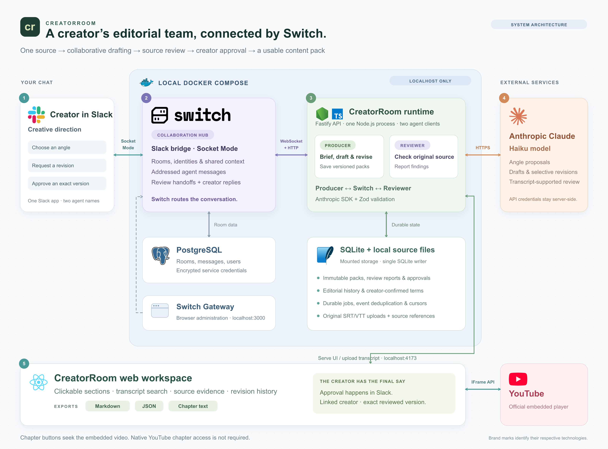

# CreatorRoom

A creator’s editorial team in Slack, powered by Switch: source-grounded content packs and navigable video sections.

A solo creator uploads a matching SRT/VTT transcript for their YouTube video. Producer proposes two creative angles in Slack, waits for a choice, then drafts a YouTube description, X thread, LinkedIn post, newsletter and navigation sections. Reviewer receives an actual addressed request through Switch, reads the original transcript, and returns source-linked findings. The creator requests selective revisions and approves an exact immutable version in Slack.

The React/Tailwind workspace provides the official YouTube player, clickable sections/evidence, searchable timestamped transcript, format tabs, review findings, version comparison and Markdown/chapter-text/JSON downloads. It has no second chat interface and publishes nothing to social platforms.

## Architecture



Slack is the collaboration surface; Switch routes the two agents’ messages and review handoffs. A local Docker deployment runs Switch, PostgreSQL, Gateway, and CreatorRoom. Claude is called from the application server. React provides source navigation and exports; approval remains in Slack.

[Architecture details](docs/architecture.md) · [Editable SVG](docs/assets/creatorroom-architecture.svg) · [Logo sources](docs/assets/LOGO-SOURCES.md)

## Why Switch is central

The live path is **Slack creator → Switch bridge → custom agent → Switch → Slack**. Producer and Reviewer are our own TypeScript clients with separate creator-owned Switch identities and API keys. Switch carries addressed messages, room membership, identity policy, shared documents and the actual agent-to-agent review handoff. Removing Switch breaks the workflow. We use neither a separate Slack bot receiver nor an incoming webhook to post replies.

Both workers, Fastify and SQLite run in one Node process to keep a single SQLite writer. React assets are served by Fastify. The official Anthropic SDK uses configurable Haiku identifiers and schema-validated output. Credentials stay server-side.


## First-time setup

Requires Docker with Compose, Node.js 24+ for local tooling, Python 3.11+, an Anthropic API key, an editable Slack custom app, and an owned video/matching transcript. No Switch Console, Mattermost, Redis, public tunnel or Docker socket mount is required.

```sh
npm ci
python3 scripts/init-env.py
./scripts/switch up -d --wait
```

The initializer creates mode-0600 local `.env` files once and never overwrites them. Do not regenerate database/master keys or change `creatorroom.local` after initial deployment. Real environment files, private runtime data, and internal planning notes are excluded from Git. Placeholder .env.example files, tests, and public setup documentation are included for reproducibility.

Fill the root `.env` locally:

| Setting | Purpose |
| --- | --- |
| ANTHROPIC_API_KEY | Anthropic Console API credential |
| ANTHROPIC_MODEL | Available model identifier; demo used claude-haiku-4-5-20251001 |
| SLACK_BOT_TOKEN | xoxb bot OAuth token, used by setup to configure Switch |
| SLACK_APP_TOKEN | xapp app-level token with connections:write |
| SLACK_TEAM_ID | Actual T… workspace identifier |
| SLACK_CHANNEL_ID | Actual dedicated demo channel identifier |
| SLACK_USER_ID | Creator’s U… member ID |
| SLACK_USERNAME | Actual Slack handle for identity directory matching |

`npm run models` verifies authentication and lists available identifiers without generating content. The application verifies its configured model before generation. Keep paid tests small; no additional provider is used.

### Slack setup

Reuse an installed custom app if you can edit it, or create one from `infra/slack-manifest.json`. The manifest comes from the pinned Switch release; optional paid user-group autocomplete and the unused Agents declaration are removed. One app represents both agents under individual display names; they are not separate Slack accounts.

1. Enable **Socket Mode** and **Interactivity**. Under Basic Information, generate an app-level token with `connections:write`.
2. Compare scopes/commands against the manifest. Enable Event Subscriptions and its bot message events, especially `message.channels` for a public demo channel. Save and reinstall after permission changes.
3. Copy the bot token from OAuth & Permissions. Record the team/channel/member IDs and put all values only in local `.env`.
4. Run the supported Gateway bootstrap and register our agents:

```sh
npm run switch:setup
npm run agents:register
```

5. Invite the app into **only the designated demo channel** and send a message. Run `python3 scripts/link-room.py` to attach both agents and bind exact opaque sender identities. If the app joined before Switch started and no room is found, `python3 scripts/link-room.py --bind-existing` binds the configured existing channel via the supported Gateway API.
6. Start the application stack:

```sh
./scripts/start
```

Type `@producer ping`. Free Slack users type the handle as plain text; autocomplete is not required. Producer should answer, address Reviewer through Switch, and Reviewer should reply. A valid token alone does not prove channel membership or incoming event subscriptions.

### Addresses and persistence

| Service | Host address | Container address |
| --- | --- | --- |
| CreatorRoom web/API | http://localhost:4173 | creatorroom:4173 |
| Switch API | http://localhost:8000 | switch:8000 |
| Browser Gateway | http://localhost:3000 | gateway:3000 |
| PostgreSQL | Not published | postgres:5432 |

All host ports bind to 127.0.0.1. `creatorroom-switch` is the isolated upstream project/network; `creatorroom-app` contains our service. Upstream Compose is preserved, with a small override disabling PostgreSQL publishing and fixing identity/restart/health behavior. Only the Gateway profile is enabled. Native ARM64 images avoid emulation. The Node base image is pinned by digest.

`.local/app` holds SQLite and original uploads. Agent and room configuration are read-only mounts. The app receives only the model secret and Slack team/channel identifiers; Slack bridge tokens are stored by Switch using its supported encrypted configuration. Secrets/private content never enter the image build context. `/api/ready` requires database, both worker sockets and Switch health. Startup retries are bounded.

```sh
./scripts/status
./scripts/diagnostics
./scripts/stop
./scripts/start
```

Normal stops preserve data. Do not use `down -v`, prune resources, or run a second app writer alongside Docker. Diagnostics do not dump secret configuration or raw logs.

## Content workflow

Open CreatorRoom → New project. Supply a title, HTTPS YouTube URL, confirmed duration, matching SRT/VTT up to 2 MiB, and audience/tone/examples/preferred/prohibited phrases. Original source is retained; transcript instructions are treated as untrusted content.

In Slack:

```text
@producer brief Focus on the practical lesson for beginners.
@producer angle 1
@producer revise linkedin Make the opening more direct and practical.
@producer revise chapters Split the longest section at the next topic change.
@producer fix F1 v5
@producer accept F1 v5 This is explicitly labelled as my personal opinion.
@producer glossary "Falco DB" => "FalkorDB"
@producer approve v6
```

Use the actual latest version, not the example number. If several projects share a room, include `project <id>` before the command. Producer waits for the angle choice. Each revision creates a new version and invalidates approval for that version; unrelated assets/IDs and chapters are preserved. Reviewer is invoked only by the addressed Switch handoff. Approvals require the linked human creator, correct room, reviewed current exact version, passing deterministic checks, and no unresolved blocking Reviewer findings. A creator may explicitly accept a model finding with a version-specific reason; this never waives deterministic errors or approves the pack. Models, agents and transcript text cannot approve.

Source references and exact/normalised quote checks are deterministic. Chapter checks include first start 00:00, ascending starts, video bounds, at least three entries and at least ten seconds per section including the last. Unsupported native chapter text is rejected. X uses 5–7 posts and a conservative 270-character budget, not platform-weighted validation. LinkedIn targets 150–250 words; newsletter 250–400.

Review is **supported by transcript**, not independently fact-checked. ASR errors in names can propagate; the creator should correct the source. Direct-quote metadata is reserved for actual verbatim quotes present in the asset. Supporting claims link to original source segments. Producer owns the brief/pack room document; Reviewer owns its review document. Each updates only its own document. References never grant external credentials; Slack gets separate readable summaries and usable local artifact links.

CreatorRoom sections navigate the official embed after readiness and preserve its controls. They do not enable native chapters on a channel. Playback/embedding errors show a fallback YouTube link; seeking is not frame precise and does not force paused playback to start.

## Verification and development

```sh
npm test
npm run build
npm run format:check
uvx ruff check scripts
uvx ruff format --check scripts
```

Browser tests and Playwright configuration are included. Install the browser once with `npx playwright install chromium`, start the app, then run `npm run test:browser` for mocked-player tests. To test your real owned video separately, set `LIVE_PROJECT_ID` and run `npm run test:browser:live`. These tests are opt-in and do not publish content. Verification covered mocked API/player behavior separately from real YouTube playback, seeking and approved exports. Mocked tests never establish live model or video functionality.

For an original offline fixture, stop the app, run `npx tsx scripts/seed.ts`, then restart it. The fixture has no real video and is labeled throughout. A fixture does not establish live integration success.

Events are persisted before cursor acknowledgement and deduplicated by source message ID. Heartbeats are independent of model work. Reconnects use persisted generation/cursor and stop on takeover or explicit gaps. Permanent model errors stop immediately; transient retries are bounded. Ambiguous external sends stop for reconciliation instead of blindly duplicating messages. An operator must investigate those cases before resuming.

## Backup and restore

`python3 scripts/backup.py` creates an ignored private backup containing a PostgreSQL custom dump, SQLite backup-API snapshot, uploads, required secret/identity files and SHA-256 manifest. Files use mode 0600; directories 0700. Backups contain credentials and source content: keep them offline and out of Git.

To restore, use a separate empty checkout with different project/network names and host ports. Restore original environment/master keys and agent/room configuration, load the dump as the schema owner into the isolated PostgreSQL instance, and place the SQLite snapshot/uploads in its `.local/app` while workers are stopped. Retain the original server identity. Start and verify the restored project before deciding whether to replace an existing deployment. Reconcile cursors after any rollback; never reset the working stack as routine troubleshooting. Backup readability/integrity is checked; destructive restore over the working stack has not been performed.

## Editorial collaboration

Your initial Slack message is now saved as creator direction, passed into angle generation and subsequent work, and snapshotted on new versions. **How this version was made** shows the chosen angle, actual recorded actions, their times, and source Switch message IDs. Existing conversations are not backfilled or invented.

`revise chapters <direction>` updates navigation and the description timestamp block together while preserving unrelated posts. Invalid boundaries are rejected before saving. A new version requires a fresh review and approval. `fix F1 v<number>` targets the named finding in that exact current version and sends a real Reviewer handoff. Reviewer rechecks all assets so unrelated blocking findings cannot disappear from the review simply because another asset changed.

`accept F1 v<number> <reason>` is an explicit creator decision about a model finding, not automatic approval. Reasons must be at least eight characters; deterministic errors cannot be accepted away. Decisions do not transfer to a new version.

`glossary "original spelling" => "preferred spelling"` records a creator-confirmed project term. It guides subsequent generation and revisions without modifying original captions, historical packs, or verbatim quotations. Request an asset revision to apply the spelling. Cross-project learned preferences and video clip rendering are outside this version.

Use `@producer help` for commands. When more than one project uses the room, prefix commands with `project <id>`. The app provides version-specific copyable Slack commands. No approval happens in the web interface.
