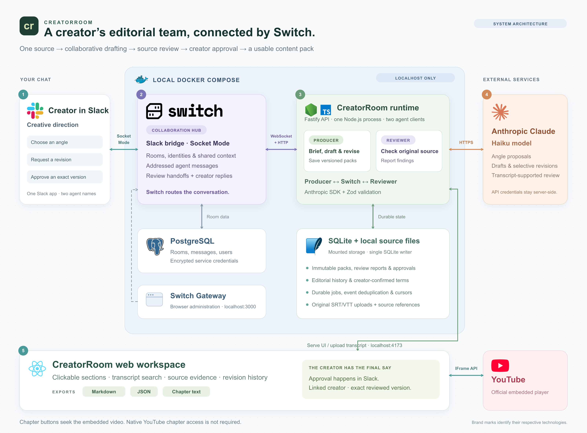

# CreatorRoom architecture

[Download the editable vector diagram](assets/creatorroom-architecture.svg). The PNG is 3200 pixels wide; all logo artwork is embedded in the SVG so it remains self-contained. [Logo sources](assets/LOGO-SOURCES.md).

## Collaboration through Switch

A creator addresses Producer in Slack. Switch’s Socket Mode bridge receives that message, resolves room membership and identity, and delivers an addressed event to Producer over its authenticated WebSocket connection. Producer replies using Switch’s HTTP operations.

When a pack needs review, Producer addresses Reviewer through Switch. Receiving that actual Switch event triggers Reviewer; a private application callback does not substitute for the handoff. Both agents use separate creator-owned identities, while one Slack app presents their names.

Creator decisions, requested changes, finding acceptance reasons, and exact-version approvals originate in Slack. The web workspace displays those decisions and offers copyable commands; it does not provide a second chat or approval endpoint.

## Local deployment and state

Docker Compose runs two isolated application projects on a shared local network:

- Switch: the released Switch server, PostgreSQL, and browser Gateway. Only the Gateway profile is enabled; Mattermost is not deployed.
- CreatorRoom: Fastify, the React production assets, Producer, and Reviewer in one Node.js process. This deliberately keeps a single SQLite writer.

Switch persists rooms, users, messages, and encrypted connector credentials in PostgreSQL. CreatorRoom persists durable jobs, immutable packs, review reports, approval records, editorial history, and project terminology in SQLite. Original transcripts live in mounted application storage. These are separate stores with separate responsibilities.

Workers persist events before acknowledging transport cursors, deduplicate message IDs, and retain identity/connection state across restarts. Retries are bounded; ambiguous external sends stop for operator reconciliation instead of blindly duplicating messages.

Host services bind to localhost. PostgreSQL has no published port. Socket Mode needs no public inbound webhook. Cloud model requests still leave the machine: the application sends the required source material to the configured Anthropic API using server-side credentials.

## Generation and review

The application uses the official Anthropic SDK with a configurable Haiku model and schema-validated output. Deterministic checks verify source references, direct quotes, format constraints, and chapter timing. Reviewer checks the original transcript and all content assets; blocking findings on unchanged content carry forward unless resolved.

Versions are immutable. Chapter edits update navigation and the description’s timestamp block together. Other formats remain unchanged. Human approval is validated against the linked creator, room, current exact version, completed review, deterministic checks, and unresolved reviewer errors. Creator decisions never waive deterministic errors or automatically approve a pack.

Review means supported by the transcript, not independently fact-checked. Creator-confirmed terminology guides new writing without rewriting original captions or historical versions.

## Browser experience

The React workspace uploads a matching SRT/VTT, displays source evidence and editorial history, and exports Markdown, JSON, and chapter text. It uses the official YouTube IFrame API to seek the embedded video when a section or evidence timestamp is selected. It does not enable native YouTube chapters or require that channel feature.

The diagram shows service responsibilities and principal data paths. PostgreSQL is a Switch service; SQLite and uploaded files are application storage, not additional independent service containers. Gateway is an administrative interface, not part of the main creative conversation.
